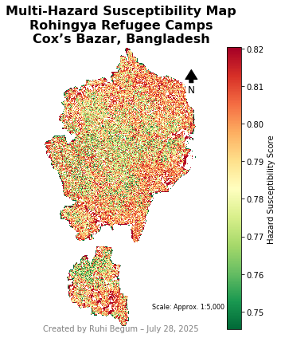
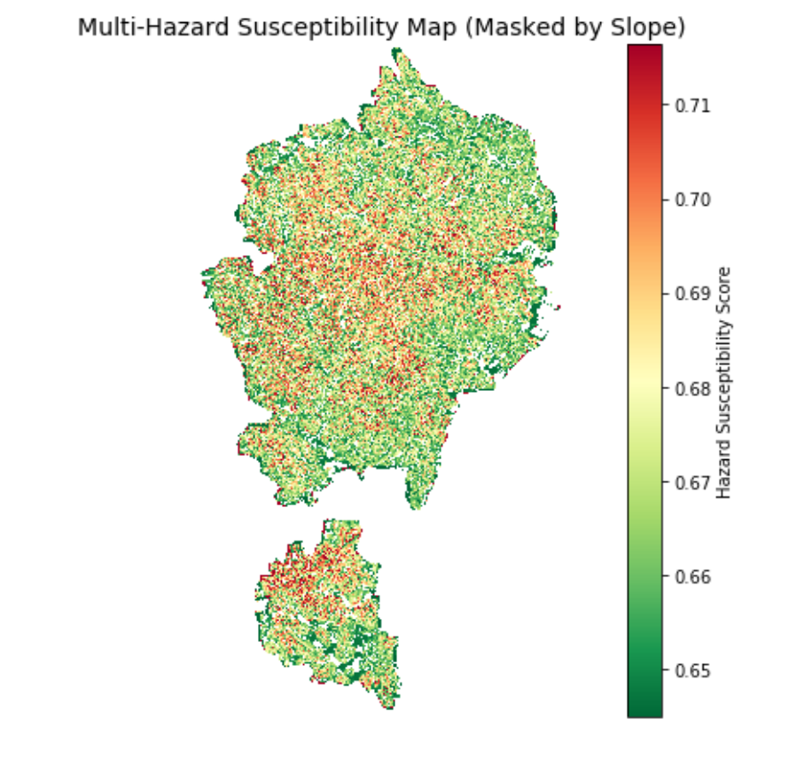

# Multi-Hazard Susceptibility Mapping with Python & AHP

Hi! I'm Ruhi, a Geoinformation Science graduate with a passion for using spatial data to make real-world decisions.
This project is based on my Master's thesis, where I created a multi-hazard susceptibility map using GIS and the Analytic Hierarchy Process (AHP).

**Goal**: To identify the areas most at risk from natural hazards by combining physical, environmental and infrastructure data in a reproducible, Python-based workflow.

---

## What this project does

The script walks you through:

1. Loading multiple geospatial layers (rainfall, slope, rivers, roads, etc.)
2. Aligning the rasters to the same spatial reference
3. Applying AHP (Analytic Hierarchy Process) to calculate a weight for each hazard factor
4. Combining the layers into one composite susceptibility map
5. Visualizing the result with a clear colour gradient (green = low risk, red = high risk)

## Data used

Each factor is a raster `.tif` file:

| Factor              | Description               | Weight role |
|---------------------|---------------------------|-------------|
| Rainfall            | Annual rainfall levels    | Benefit     |
| Slope (DEM-based)   | Derived from elevation    | Cost        |
| River proximity     | Distance from rivers      | Benefit     |
| Faultline proximity | Distance from faults      | Cost        |
| Road proximity      | Accessibility             | Benefit     |
| Cyclone paths       | Historical storm tracks   | Cost        |
| Cyclone shelters    | Availability of shelters  | Benefit     |

## AHP explained

AHP assigns weights based on expert judgement.
This is the pairwise comparison matrix I created after a literature review, domain insights and expert advice (1 = equal importance, 9 = extremely more important; a value below 1 means the column factor matters more than the row factor).

| Criteria  | Rainfall | Slope | River | Faultline | Roads | CycloneP | CycloneS |
|-----------|----------|-------|-------|-----------|-------|----------|----------|
| Rainfall  | 1        | 3     | 3     | 3         | 2     | 2        | 2        |
| Slope     | 1/3      | 1     | 2     | 3         | 4     | 2        | 2        |
| River     | 1/3      | 1/2   | 1     | 4         | 2     | 2        | 2        |
| Faultline | 1/2      | 1/2   | 1/4   | 1         | 2     | 2        | 2        |
| Roads     | 1/2      | 1/4   | 1/2   | 1/2       | 1     | 2        | 2        |
| CycloneP  | 1/2      | 1/2   | 1/2   | 1/2       | 1/2   | 1        | 1/2      |
| CycloneS  | 1/2      | 1/2   | 1/2   | 1/2       | 1/2   | 2        | 1        |

Resulting weights:

| Factor    | Weight |
|-----------|--------|
| Rainfall  | 26.8%  |
| Slope     | 20.1%  |
| River     | 15.9%  |
| Faultline | 11.8%  |
| Roads     | 9.9%   |
| CycloneS  | 8.6%   |
| CycloneP  | 6.9%   |

Consistency check: CI = 0.1472, **CR = 0.1115**. This is slightly above the usual 0.10 threshold, so the judgements are borderline consistent. The weights are used as they are, and the matrix could be refined in a future version.

## Results

- Final susceptibility map, with values normalized between the 2nd and 98th percentiles
- Colour-coded gradient: green = low risk, red = high risk
- Masked by the slope raster to exclude irrelevant areas
- Easy-to-read layout and reproducible steps

## Limitations

- The weights come from expert judgement and literature review, so they reflect those choices.
- The AHP Consistency Ratio is 0.1115, slightly above the 0.10 guideline, and the matrix is not strictly reciprocal in a few entries.
- The map shows relative susceptibility, not the probability of a hazard event.

## Tools used

- Python
- Rasterio for raster processing
- NumPy for calculations
- Matplotlib for visualization
- AHP weighting logic

## How to run it yourself

1. Clone this repository or download the files.
2. Install the requirements: `python -m pip install -r requirements.txt`
3. Place your `.tif` files inside a folder named `thesis_data/`.
4. Run `python multi_hazard_model.py`.
5. The final map is shown at the end.

## About me

I'm Ruhi, a GIS professional with a background in hazard modelling and data analysis.
I currently work at ROSEN Group, where I explore the intersection of geospatial intelligence and real-world applications.

This portfolio is my way of sharing how raw spatial data can turn into meaningful insights, one pixel at a time.

## Let's connect

- GitHub: [@ruhigeo](https://github.com/ruhigeo)
- LinkedIn: [linkedin.com/in/ruhi-begum](https://linkedin.com/in/ruhi-begum)

> "Maps are not just tools. They're stories waiting to be told."
